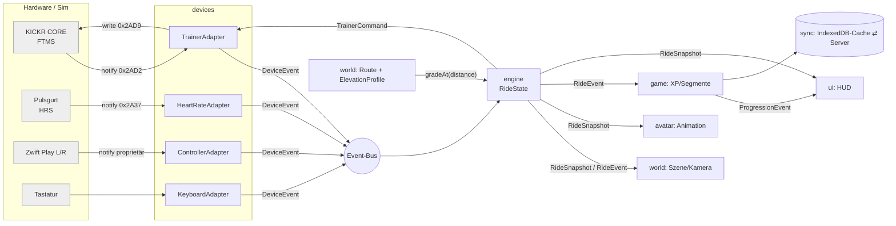
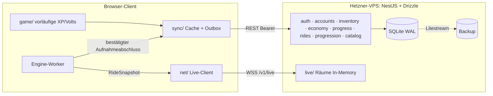

# 01 – Architektur

## Grundprinzip: ein Besitzer pro State

| State                                                                      | Besitzer                                              | Wer liest                                        | Wie wird geändert                                                                  |
| -------------------------------------------------------------------------- | ----------------------------------------------------- | ------------------------------------------------ | ---------------------------------------------------------------------------------- |
| Verbindungsstatus, Rohdaten der Geräte                                     | `devices/` (je Adapter)                               | engine, ui                                       | nur Adapter selbst                                                                 |
| `RideState` (Position, Tempo, Gang, Zeit, Summen, Bots, Drafting, Pickups) | `packages/engine` (nur `internal/`)                   | world, avatar, game, ui (als `RideSnapshot`)     | nur `engine.tick()` und Engine-Intents                                             |
| `Route` / `ElevationProfile`                                               | `world/` (Laden/Erzeugen)                             | engine (Steigung), world (Mesh), game (Segmente) | unveränderlich nach Laden                                                          |
| `AvatarConfig`                                                             | `avatar/`                                             | ui (Garage), game (Unlock-Prüfung)               | Intent `avatar.setConfig`                                                          |
| `RiderProfile` (Gewicht, Größe, FTP, Kettenblatt …)                        | Server `accounts/`, Client-Cache in `sync/`           | engine (zu Fahrtbeginn), avatar (Größe), ui      | Intent `profile.update` → `sync/` → `PUT /v1/me/profile`                           |
| Mitgliedsstufe, VIP und getrennte Adminberechtigung                        | Server `accounts/`, Spiegel unter `AccountSync`       | Konto-Menü, geschützte Adminrouten               | Mitgliedschaft über Admin-PATCH, Rolle ausschließlich per Operator-CLI             |
| `Progression`, Inventar, Volts (verbindlich)                               | **Server** (`progression/`, `inventory/`, `economy/`) | Client über `sync/`-Cache                        | nur Server, ausgelöst durch akzeptierte Fahrt-Uploads, Progress-Bereiche und Käufe |
| Progress-Consent, Journalbindung, Session-Generation, Highwater            | **Server** (`progress/`)                              | Client über `sync/progressSync`                  | explizite Zustimmung, authentifizierte Checkpoint-Annahme                          |
| Lokale Progress-Outbox                                                     | `apps/web/src/sync`                                   | UI über schmales Statusport                      | `progressSync`, nach Zustimmung und nur für BLE                                    |
| Vorläufige Fahrt-Belohnungen (XP/Volts live)                               | `game/`                                               | ui                                               | game, aus Ride-Events; nach Upload durch Server-Antwort ersetzt                    |
| Outbox (unhochgeladene Fahrten)                                            | `sync/`                                               | ui (Status)                                      | sync                                                                               |
| Laufende lokale Aufnahme mit echter Zeitachse                              | `game/rideRecorder`                                   | ui                                               | explizite Aufnahmebefehle, rohe Geräteereignisse, Snapshot-Distanz                 |
| Abgeschlossene lokale Aufnahmen                                            | `sync/`                                               | ui über injizierte Schnittstelle                 | validiertes Speichern in separater IndexedDB                                       |
| UI-Zustand (offene Panels)                                                 | `ui/`                                                 | –                                                | ui                                                                                 |
| Anwendungssession und private Bearer-Zugangsdaten                          | `sync/applicationSession`                             | Kontopanel über tokenfreie Ansicht               | ausdrückliche Anmeldung, Übergabe, Wiederherstellung und Abmeldung                 |

Kommunikation: **typisierter Event-Bus** (`packages/shared/src/bus.ts`) für diskrete Ereignisse + **Snapshot-Pull** pro Frame für kontinuierliche Werte (Render-Loop holt `engine.snapshot()`).

## Datenfluss



## Loops und Takt

- **Engine-Tick:** fest 20 Hz (`dtS = 0.05`) im Dedicated Web Worker, unabhängig vom Render-Loop. Der Akkumulator verarbeitet höchstens 120 Ticks pro Aufwachung. Größere Lücken erzeugen `ride.clockSkipped`; veraltete Trainerdaten führen zum Ausrollen. Entscheidung und Grenzen stehen in ADR-011. Chrome Page Freezing mit aktiver BLE-Verbindung bleibt manuell zu prüfen.
- **Trainer-Kommandos:** max. 4 Hz, nur bei Änderung (Grade-Delta ≥ 0,1 % oder Gangwechsel), serialisiert (FTMS erlaubt nur eine ausstehende Control-Point-Prozedur).
- **Render:** `requestAnimationFrame`, interpoliert zwischen den letzten zwei Engine-Snapshots.

## Kerntypen (Design-Skizzen, keine Implementierung)

```ts
// packages/shared/src/units.ts – nur Aliase zur Lesbarkeit
type Watts = number;
type Rpm = number;
type Mps = number;
type Meters = number;
type Seconds = number;
type Pct = number;
type Bpm = number;
type Kg = number;

// devices → bus
type DeviceKind = "trainer" | "heartRate" | "controller" | "keyboard";
type DeviceEvent =
  | { type: "trainer.data"; tS: Seconds; powerW?: Watts; cadenceRpm?: Rpm; speedMps?: Mps }
  | { type: "hr.data"; tS: Seconds; bpm: Bpm; rrMs?: number[] }
  | {
      type: "controller.button";
      tS: Seconds;
      button: ControllerButton;
      pressed: boolean;
      source: string;
    }
  | { type: "controller.battery"; tS: Seconds; percent: number }
  | {
      type: "trainer.controlResult";
      tS: Seconds;
      opCode: number;
      result: "success" | "notSupported" | "invalidParam" | "failed" | "notPermitted";
    }
  | { type: "device.status"; tS: Seconds; kind: DeviceKind; id: string; status: ConnectionStatus };

type ConnectionStatus =
  | "disconnected"
  | "connecting"
  | "handshaking"
  | "ready"
  | "reconnecting"
  | "error";

// Logische Tasten. Rohbits → logisch passiert im ControllerAdapter über eine ButtonMap.
type ControllerButton =
  | "shiftUp"
  | "shiftDown" // einzig Pflicht
  | "navUp"
  | "navDown"
  | "navLeft"
  | "navRight"
  | "confirm"
  | "back"
  | "powerUp"
  | "brake";

interface DeviceAdapter<C = never> {
  readonly kind: DeviceKind;
  connect(opts?: { remembered?: BluetoothDevice }): Promise<void>;
  disconnect(): Promise<void>;
  status(): ConnectionStatus;
  send?(cmd: C): Promise<void>; // nur Trainer
}

// engine → devices
type TrainerCommand =
  | { type: "simulation"; gradePct: Pct; windMps: Mps; crr: number; cwKgPerM: number } // FTMS 0x11
  | { type: "targetPower"; powerW: Watts } // FTMS 0x05 (ERG)
  | { type: "resistance"; level: number }; // FTMS 0x04

// engine
interface GearModel {
  readonly ratios: readonly number[]; // virtuelle Übersetzungen (Kettenblatt/Ritzel), 24 Einträge
  readonly physicalRatio: number; // reale Übersetzung am Trainer (Kettenblatt / Zwift Cog), kalibriert
  index: number; // 0-basiert, aktueller Gang
}

interface RiderParams {
  massKg: Kg;
  bikeMassKg: Kg;
  cdaM2: number;
  crr: number;
  wheelCircM: Meters;
}

interface RideState {
  tS: Seconds; // Fahrzeit (ohne Pausen)
  distanceM: Meters; // Position entlang der Route (Lap-übergreifend)
  lap: number;
  speedMps: Mps; // virtuelles Tempo aus Physik
  powerW: Watts;
  cadenceRpm: Rpm;
  hrBpm?: Bpm; // letzte Messwerte (geglättet)
  gradePct: Pct; // aktuelle Streckensteigung
  gear: { index: number; ratio: number };
  elevationGainM: Meters;
  energyKj: number;
  paused: boolean;
  trainerMode: "simulation" | "erg" | "passive";
  mode:
    | { kind: "normal" }
    | { kind: "fun"; heldItem?: FunItemId; activeItem?: FunItemId; activeRemainingS: Seconds }; // Spielmodus als Union (ADR-028)
}
type RideSnapshot = Readonly<RideState> & {
  worldPos: { x: number; y: number; z: number };
  headingRad: number;
};

type RideEvent =
  | { type: "ride.started" }
  | { type: "ride.ended"; summary: RideSummary }
  | { type: "gear.changed"; from: number; to: number }
  | { type: "distance.tick"; deltaM: Meters; deltaElevM: Meters } // für XP
  | { type: "segment.entered" | "segment.exited"; segmentId: string; tS: Seconds }
  | { type: "lap.completed"; lap: number; tS: Seconds };

// world
interface ElevationProfile {
  // Stützstellen alle ~5–10 m, monoton in distanceM
  samples: ReadonlyArray<{ distanceM: Meters; elevationM: Meters }>;
  elevationAt(distanceM: Meters): Meters;
  gradeAt(distanceM: Meters, smoothingM?: Meters): Pct; // geglättet, damit der Trainer nicht ruckelt
}
interface Route {
  id: string;
  name: string;
  lengthM: Meters;
  loop: boolean;
  centerline: ReadonlyArray<{ x: number; z: number }>; // 2D-Spline-Kontrollpunkte; y kommt aus ElevationProfile
  profile: ElevationProfile;
  segments: ReadonlyArray<SegmentDef>;
  scenery: string; // Biome/Theme-ID für world/
}
interface SegmentDef {
  id: string;
  name: string;
  kind: "sprint" | "kom" | "lap";
  startM: Meters;
  endM: Meters;
}

// avatar
interface AvatarConfig {
  rider: {
    skinTone: string;
    jerseyId: string;
    jerseyColors: [string, string];
    helmetId: string;
    helmetColor: string;
    shoesId: string;
  };
  bike: { frameId: string; frameColor: string; wheelsId: string; barTapeColor?: string };
}

// packages/shared/src/api – Zod-Schemas; Server-autoritativ, Client cached
interface RiderProfile {
  displayName: string;
  massKg: number;
  heightCm: number;
  ftpW?: number;
  maxHrBpm?: number;
  bike: { massKg: number; chainringTeeth: number; cogTeeth: number; wheelCircM: number };
  gearPreset: string;
  units: "metric" | "imperial";
}
interface Inventory {
  items: ReadonlyArray<{
    itemId: string;
    source: "default" | "level" | "badge" | "shop" | "distance";
    acquiredAt: string;
  }>;
}
interface Wallet {
  voltsBalance: number;
} // Server: Summe des Ledgers
interface Progression {
  xp: number;
  level: number;
  totalDistanceM: Meters;
  totalElevationM: Meters;
  totalRideS: Seconds;
  badges: ReadonlyArray<{ id: string; earnedAt: string }>;
  personalBests: Record<string /*segmentId*/, { timeS: Seconds; at: string; avgPowerW: Watts }>;
  schemaVersion: number;
}
```

## Repo-Layout (pnpm workspaces, ADR-006)

```
apps/
  web/            @voltonaut/web
    src/main.ts           Composition Root (nur Verdrahtung)
    src/world/            RenderSystems: environment, terrain, scenery, crowd, pickups, effects, camera, post (ADR-008)
    src/avatar/           Fahrer-/Rad-Modelle, Animation, Customizing
    src/game/             Fahrtsitzung + Engine-Worker, vorläufige XP/Volts, Segment-HUD-Logik
    src/ui/               HUD, connect, garage, shop, profile, summary, login
    src/sync/             Cache + Outbox + API-Client (ab E5)
    src/net/              Live-Gruppenfahrt-Client (ab E9)
    debug/ble.html        Sniffer
    e2e/                  Playwright (E2E, visuell, Perf)
    public/assets/        komprimierte GLB/KTX2 + LICENSES.md
  server/         @voltonaut/server   NestJS-Module (08-backend.md), drizzle/ Migrationen
packages/
  shared/         Typen, Einheiten, Zod-Schemas (api, ws, ride-upload), Event-Bus-Typen
  engine/         src/{physics,gears,ride,bots,drafting,segments,trainer,journal}/ + src/internal/ (mutierbarer RideState)
  rules/          src/{xp,economy,badges,catalog,levels}/ + data/*.json
  ble/            src/{ftms,hrs,cps,zwift-play,keyboard,sim,replay}/
tools/oxlint/anti-slop/   scripts/   assets-src/   fixtures/{ble,rides,api}/   docs/
```

Zuordnung der früheren Kurznamen: `devices/` → `packages/ble`, `sim/` → `packages/ble/src/sim`, `engine/` → `packages/engine`, `shared/` → `packages/shared`, Spielregeln → `packages/rules`, `server/` → `apps/server`.

## Backend & Sync



- `sync/` (Client) besitzt den lokalen Spiegel von `/v1/me` und die Outbox; alle anderen Client-Module lesen daraus. Ohne Server/Account: Gastmodus, nur Cache + Outbox.
- [E5-10](specs/E5-10-membership-admin.md) ergänzt Normal/Premium/Pro und unabhängiges VIP. `accounts.account_status` besitzt diese Angaben und die getrennte Rolle. Fehlende Zeilen bedeuten Normal, nicht VIP und nicht Admin. `AuthGuard` authentifiziert unverändert. Admin-Schreibtransaktionen lesen die aktuelle Rolle erneut. `AccountSync.administration` verwendet dieselbe generationsgebundene private Lease und hält den Schreibbesitz bis zum vollständigen Nachlesen. Logout und Kontowechsel entwerten alte Aktionen. Keine Admin-Outbox, kein automatischer Schreibretry und keine HTTP-Rollenvergabe.
- [E5-11](specs/E5-11-account-data-export-deletion.md) exportiert ausschließlich Daten der authentifizierten Session einschließlich Identitäten und Volts-Journal. Die Löschung läuft atomar über die Besitzer-Services; `users` bleibt als pseudonymer Tombstein mit serverseitig gekeyeten E-Mail-/Identitäts-HMACs erhalten. Trigger verhindern spätere INSERT/UPDATE-Versuche auf allen kontobezogenen Tabellen. Der Browser entfernt nach bestätigter Löschung nur Outbox-Einträge exakt dieses API-Origin/Kontos; lokale Fahrtarchive und das gemeinsame Gastprofil bleiben erhalten.
- [E10-04](specs/E10-04-complete-ride-delivery.md) verlegt die Aufnahme aus E10-01 in den vorhandenen Engine-Worker. Er hält Journal und ausgewähltes Fenster getrennt und bestätigt Grenzen in Actor-Reihenfolge. Aufnahmebefehle verändern weder Advances noch Pose. `sync` speichert bis zu 20 Abschlüsse in `voltonaut-local-rides`: normale rohe V2-Journale, unveränderte historische V1-Daten oder ausdrücklich lokale Tracks nach Journalverlust. Ein Abschluss bleibt bis Archivcommit oder ausdrücklicher Nutzerentscheidung gesperrt. TCX braucht weder Konto noch Netzwerk.
- `/v2/rides` ersetzt den bisherigen Fahrtenpfad vollständig. `rides` hält unveränderliche Nutzlast, Beleg, vollständige Nachrechnung und servereigene TCX-Bytes. Historische V1-Daten bleiben `unverified/legacy_missing_replay`; sie werden nicht nachträglich aufgewertet. [E5-09](specs/E5-09-account-bound-sync.md) behält eine ausdrückliche Kontozuordnung und eine einzige IndexedDB-Outbox. `applicationSession` erteilt tokenlose, origin- und generationsgebundene Fähigkeiten. [E0-09](specs/E0-09-private-api-routes.md) beschreibt jeden API-Aufruf als Route mit Methode, Schemas und Cookie-Regel. `sync/apiRoute.ts` ist der einzige Fetch-, Parse- und Fehlerpfad, auch für die Sitzungsrouten vor einer Lease. Die Lease besteht aus schmalen Ports (Profil, Fahrten, Daten, Mitgliedschaft, Progress, Identitäten, Shop, Strava). Jeder Konsument typisiert nur die Ports, die er aufruft. `accountSync` besitzt nur den Kontospiegel und diese Outbox. Strava besitzt getrennt seine Verbindung und dauerhaften serverseitigen Versandaufträge.
- Auth-Ziel laut [ADR-013](decisions/ADR-013-cloudflare-access-oidc.md): Cloudflare Access als OIDC-Broker, keine Proxy-Sperre vor Webseite oder API. Der Server besitzt stabile Accounts, Identitätszuordnungen und eigene Bearer-Sessions. Login startet nur nach Nutzerklick; anonyme Fahrt benötigt weder Storage noch Netzwerk. [E5-06](specs/E5-06-oidc-server-login.md) liefert den serverseitigen Codeflow und die browsergebundene Einmalübergabe. [E5-08](specs/E5-08-browser-oidc-session.md) ergänzt das Browserkonto. `sync` besitzt Session, HTTP und optionale Persistenz; `ui` erhält nur Status und servervalidierte Nutzer. Zusätzliche Identitätsverknüpfungen und echter Pilot bleiben offen.
- Access-App und begrenzte Pilot-Policy sind separat eingerichtet, siehe [E5-04](specs/E5-04-access-oidc-pilot-setup.md). Das ersetzt keinen echten Anbieterpilot.
- [E10-02](specs/E10-02-replay-consistency.md) definiert das V2-Journal ab Engine-Initialisierung. E10-04 verbindet Worker-Erfassung, API und ausdrückliche Strava-Auslieferung. Die Quellenrichtlinie bleibt standardmäßig deaktiviert. `declared_ble_v1` ist eine explizite BLE-Selbstauskunft, kein Hardwareattest und keine Belohnungsfreigabe. Die gebaute Gesamtstrecke ist gegen lokale Anbieter und native GATT-Fakes softwaregeprüft. Echte Hardware, Anbieterzustimmung und Produktion bleiben getrennte Abnahmen.
- [E0-07](specs/E0-07-journal-codec.md): Der Fahrtjournal-Codec in `packages/engine/src/journal/` ist die einzige Übersetzung zwischen `DeviceEvent`, Journaleintrag, Engine und Replay-Snapshot. Der Worker-Recorder kodiert damit, `rides/replay` rechnet damit nach; beide nutzen `PHYSICS_REVISION`. Journal-Puffer, Fenster und Grenzbestätigung bleiben beim Worker (ADR-018), Event- und Kommandovergleich beim Server.
- `net/` liest `RideSnapshot` (sendet eigene Distanz 2–4 Hz) und besitzt `RemoteRider[]`; world/avatar rendern Remote-Fahrer nur daraus. Für Windschatten hinter Remote-Fahrern reicht `net/` deren Distanz/Versatz als Engine-Input weiter (v2).
- `packages/engine`, `packages/rules`, `packages/shared` enthalten Code, den Client **und** Server nutzen: Physik, Gänge, Bots/Drafting, Level-Tabelle, Badge-Prädikate, Item-Katalog, Zod-API-Schemas. So rechnet der Server Fahrten mit derselben Logik nach. So rechnet der Server Fahrten mit derselben Logik nach.
- Details: `08-backend.md`, ADR-004, ADR-005.

## Engine-Erweiterungen für das Spiel

`RideState` enthält neben dem eigenen Fahrer: `bots: BotState[]` (deterministisch per Seed), `draft: { leaderId?: string; cdaFactor: number }`, `pickups: { collected: string[] }`, `powerUp?: { id; untilS }`, `lateralM` (Spur). Render-Systeme bekommen daraus `RiderView[]`.

## Composition Root

`main.ts` erzeugt in dieser Reihenfolge: Bus → `sync/` (Cache optional laden, vorhandene Session optional prüfen; Storage- und Netzfehler blockieren keine Fahrt, kein automatischer Login) → Adapter (echt oder `sim/` bei `?sim=1`) → RiderProfile aus Cache → Fahrtsitzung → Ansichten → Tastatur, Geräte-Dialog, Spielmenü → optional `net/`. Nur hier wird entschieden, ob Sim- oder Echtgeräte laufen; alle anderen Module merken keinen Unterschied.

Die **Fahrtsitzung** `game/rideSession.ts` ([E0-14](specs/E0-14-ride-session.md)) ist die einzige Hauptthread-Seite der laufenden Fahrt. `createRideSession` erhält Bus, Route, Profil, Quelle, Uhrfaktor, Trainer-Senke und Worker-Port-Fabrik. Sie prüft die Route, bevor ein Worker entsteht. Der `engine-link` sendet `engine.init` schon beim Erzeugen; erst danach abonniert die Sitzung die Bus-Ereignisse `ENGINE_INPUT_TYPES`. Eingaben vor der Initialisierung sind damit nicht darstellbar. Die Sitzung besitzt Verbindungsmonitor, Segmentvorschau und `dispose`. Sie liefert ein Lesemodell (Snapshot, Verbindung, Segmente, tatsächlicher Modus aus `snapshot.mode`), Aufnahmesteuerung und die Modusabsicht `requestMode`. Den Modus besitzt weiter die Engine (ADR-028 §5); der Worker lehnt nicht aufnehmbare Modi während einer Aufnahme zusätzlich ab. `rideViews.ts` hängt HUD, Aufnahmepanel, Moduswahl und 3D-Szene an diese Sitzung. Tests treiben die Sitzung über einen In-Process-Loopback zum echten Worker-Treiber (`game/testdata/loopbackWorker.ts`) mit manueller Uhr.
