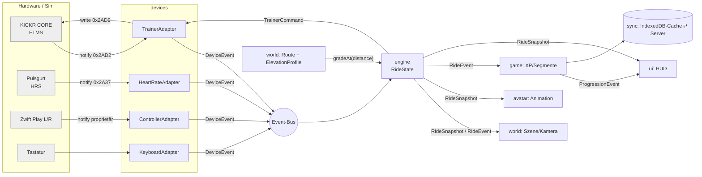
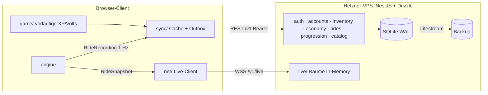

# 01 – Architektur

## Grundprinzip: ein Besitzer pro State

| State                                                                      | Besitzer                                              | Wer liest                                        | Wie wird geändert                                               |
| -------------------------------------------------------------------------- | ----------------------------------------------------- | ------------------------------------------------ | --------------------------------------------------------------- |
| Verbindungsstatus, Rohdaten der Geräte                                     | `devices/` (je Adapter)                               | engine, ui                                       | nur Adapter selbst                                              |
| `RideState` (Position, Tempo, Gang, Zeit, Summen, Bots, Drafting, Pickups) | `packages/engine` (nur `internal/`)                   | world, avatar, game, ui (als `RideSnapshot`)     | nur `engine.tick()` und Engine-Intents                          |
| `Route` / `ElevationProfile`                                               | `world/` (Laden/Erzeugen)                             | engine (Steigung), world (Mesh), game (Segmente) | unveränderlich nach Laden                                       |
| `AvatarConfig`                                                             | `avatar/`                                             | ui (Garage), game (Unlock-Prüfung)               | Intent `avatar.setConfig`                                       |
| `RiderProfile` (Gewicht, Größe, FTP, Kettenblatt …)                        | Server `accounts/`, Client-Cache in `sync/`           | engine (zu Fahrtbeginn), avatar (Größe), ui      | Intent `profile.update` → `sync/` → `PUT /v1/me/profile`        |
| `Progression`, Inventar, Volts (verbindlich)                               | **Server** (`progression/`, `inventory/`, `economy/`) | Client über `sync/`-Cache                        | nur Server, ausgelöst durch akzeptierte Fahrt-Uploads und Käufe |
| Vorläufige Fahrt-Belohnungen (XP/Volts live)                               | `game/`                                               | ui                                               | game, aus Ride-Events; nach Upload durch Server-Antwort ersetzt |
| Outbox (unhochgeladene Fahrten)                                            | `sync/`                                               | ui (Status)                                      | sync                                                            |
| UI-Zustand (offene Panels)                                                 | `ui/`                                                 | –                                                | ui                                                              |

Kommunikation: **typisierter Event-Bus** (`packages/shared/src/bus.ts`) für diskrete Ereignisse + **Snapshot-Pull** pro Frame für kontinuierliche Werte (Render-Loop holt `engine.snapshot()`).

## Datenfluss



## Loops und Takt

- **Engine-Tick:** fest 20 Hz (`dtS = 0.05`) im Dedicated Web Worker, unabhängig vom Render-Loop. Der Akkumulator verarbeitet höchstens 120 Ticks pro Aufwachung. Größere Lücken erzeugen `ride.clockSkipped`; veraltete Trainerdaten führen zum Ausrollen. Entscheidung und Grenzen stehen in ADR-011. Chrome Page Freezing mit aktiver BLE-Verbindung bleibt manuell zu prüfen.
- **Trainer-Kommandos:** max. 4 Hz, nur bei Änderung (Grade-Delta ≥ 0,1 % oder Gangwechsel), serialisiert (FTMS erlaubt nur eine ausstehende Control-Point-Prozedur).
- **Render:** `requestAnimationFrame`, interpoliert zwischen den letzten zwei Engine-Snapshots.

## Kerntypen (Design-Skizzen, keine Implementierung)

```ts
// packages/shared/src/units.ts – nur Aliase zur Lesbarkeit
type Watts = number;
type Rpm = number;
type Mps = number;
type Meters = number;
type Seconds = number;
type Pct = number;
type Bpm = number;
type Kg = number;

// devices → bus
type DeviceKind = "trainer" | "heartRate" | "controller" | "keyboard";
type DeviceEvent =
  | { type: "trainer.data"; tS: Seconds; powerW?: Watts; cadenceRpm?: Rpm; speedMps?: Mps }
  | { type: "hr.data"; tS: Seconds; bpm: Bpm; rrMs?: number[] }
  | {
      type: "controller.button";
      tS: Seconds;
      button: ControllerButton;
      pressed: boolean;
      source: string;
    }
  | { type: "controller.battery"; tS: Seconds; percent: number }
  | {
      type: "trainer.controlResult";
      tS: Seconds;
      opCode: number;
      result: "success" | "notSupported" | "invalidParam" | "failed" | "notPermitted";
    }
  | { type: "device.status"; tS: Seconds; kind: DeviceKind; id: string; status: ConnectionStatus };

type ConnectionStatus =
  | "disconnected"
  | "connecting"
  | "handshaking"
  | "ready"
  | "reconnecting"
  | "error";

// Logische Tasten. Rohbits → logisch passiert im ControllerAdapter über eine ButtonMap.
type ControllerButton =
  | "shiftUp"
  | "shiftDown" // einzig Pflicht
  | "navUp"
  | "navDown"
  | "navLeft"
  | "navRight"
  | "confirm"
  | "back"
  | "powerUp"
  | "brake";

interface DeviceAdapter<C = never> {
  readonly kind: DeviceKind;
  connect(opts?: { remembered?: BluetoothDevice }): Promise<void>;
  disconnect(): Promise<void>;
  status(): ConnectionStatus;
  send?(cmd: C): Promise<void>; // nur Trainer
}

// engine → devices
type TrainerCommand =
  | { type: "simulation"; gradePct: Pct; windMps: Mps; crr: number; cwKgPerM: number } // FTMS 0x11
  | { type: "targetPower"; powerW: Watts } // FTMS 0x05 (ERG)
  | { type: "resistance"; level: number }; // FTMS 0x04

// engine
interface GearModel {
  readonly ratios: readonly number[]; // virtuelle Übersetzungen (Kettenblatt/Ritzel), 24 Einträge
  readonly physicalRatio: number; // reale Übersetzung am Trainer (Kettenblatt / Zwift Cog), kalibriert
  index: number; // 0-basiert, aktueller Gang
}

interface RiderParams {
  massKg: Kg;
  bikeMassKg: Kg;
  cdaM2: number;
  crr: number;
  wheelCircM: Meters;
}

interface RideState {
  tS: Seconds; // Fahrzeit (ohne Pausen)
  distanceM: Meters; // Position entlang der Route (Lap-übergreifend)
  lap: number;
  speedMps: Mps; // virtuelles Tempo aus Physik
  powerW: Watts;
  cadenceRpm: Rpm;
  hrBpm?: Bpm; // letzte Messwerte (geglättet)
  gradePct: Pct; // aktuelle Streckensteigung
  gear: { index: number; ratio: number };
  elevationGainM: Meters;
  energyKj: number;
  paused: boolean;
  trainerMode: "simulation" | "erg" | "passive";
}
type RideSnapshot = Readonly<RideState> & {
  worldPos: { x: number; y: number; z: number };
  headingRad: number;
};

type RideEvent =
  | { type: "ride.started" }
  | { type: "ride.ended"; summary: RideSummary }
  | { type: "gear.changed"; from: number; to: number }
  | { type: "distance.tick"; deltaM: Meters; deltaElevM: Meters } // für XP
  | { type: "segment.entered" | "segment.exited"; segmentId: string; tS: Seconds }
  | { type: "lap.completed"; lap: number; tS: Seconds };

// world
interface ElevationProfile {
  // Stützstellen alle ~5–10 m, monoton in distanceM
  samples: ReadonlyArray<{ distanceM: Meters; elevationM: Meters }>;
  elevationAt(distanceM: Meters): Meters;
  gradeAt(distanceM: Meters, smoothingM?: Meters): Pct; // geglättet, damit der Trainer nicht ruckelt
}
interface Route {
  id: string;
  name: string;
  lengthM: Meters;
  loop: boolean;
  centerline: ReadonlyArray<{ x: number; z: number }>; // 2D-Spline-Kontrollpunkte; y kommt aus ElevationProfile
  profile: ElevationProfile;
  segments: ReadonlyArray<SegmentDef>;
  scenery: string; // Biome/Theme-ID für world/
}
interface SegmentDef {
  id: string;
  name: string;
  kind: "sprint" | "kom" | "lap";
  startM: Meters;
  endM: Meters;
}

// avatar
interface AvatarConfig {
  rider: {
    skinTone: string;
    jerseyId: string;
    jerseyColors: [string, string];
    helmetId: string;
    helmetColor: string;
    shoesId: string;
  };
  bike: { frameId: string; frameColor: string; wheelsId: string; barTapeColor?: string };
}

// packages/shared/src/api – Zod-Schemas; Server-autoritativ, Client cached
interface RiderProfile {
  displayName: string;
  massKg: number;
  heightCm: number;
  ftpW?: number;
  maxHrBpm?: number;
  bike: { massKg: number; chainringTeeth: number; cogTeeth: number; wheelCircM: number };
  gearPreset: string;
  units: "metric" | "imperial";
}
interface Inventory {
  items: ReadonlyArray<{
    itemId: string;
    source: "default" | "level" | "badge" | "shop" | "distance";
    acquiredAt: string;
  }>;
}
interface Wallet {
  voltsBalance: number;
} // Server: Summe des Ledgers
interface Progression {
  xp: number;
  level: number;
  totalDistanceM: Meters;
  totalElevationM: Meters;
  totalRideS: Seconds;
  badges: ReadonlyArray<{ id: string; earnedAt: string }>;
  personalBests: Record<string /*segmentId*/, { timeS: Seconds; at: string; avgPowerW: Watts }>;
  schemaVersion: number;
}
```

## Repo-Layout (pnpm workspaces, ADR-006)

```
apps/
  web/            @voltonaut/web
    src/main.ts           Composition Root (nur Verdrahtung)
    src/world/            RenderSystems: environment, terrain, scenery, crowd, pickups, effects, camera, post (ADR-008)
    src/avatar/           Fahrer-/Rad-Modelle, Animation, Customizing
    src/game/             vorläufige XP/Volts, Segment-HUD-Logik
    src/ui/               HUD, connect, garage, shop, profile, summary, login
    src/sync/             Cache + Outbox + API-Client (ab E5)
    src/net/              Live-Gruppenfahrt-Client (ab E9)
    debug/ble.html        Sniffer
    e2e/                  Playwright (E2E, visuell, Perf)
    public/assets/        komprimierte GLB/KTX2 + LICENSES.md
  server/         @voltonaut/server   NestJS-Module (08-backend.md), drizzle/ Migrationen
packages/
  shared/         Typen, Einheiten, Zod-Schemas (api, ws, ride-upload), Event-Bus-Typen
  engine/         src/{physics,gears,ride,bots,drafting,segments,trainer}/ + src/internal/ (mutierbarer RideState)
  rules/          src/{xp,economy,badges,catalog,levels}/ + data/*.json
  ble/            src/{ftms,hrs,cps,zwift-play,keyboard,sim,replay}/
tools/oxlint/anti-slop/   scripts/   assets-src/   fixtures/{ble,rides,api}/   docs/
```

Zuordnung der früheren Kurznamen: `devices/` → `packages/ble`, `sim/` → `packages/ble/src/sim`, `engine/` → `packages/engine`, `shared/` → `packages/shared`, Spielregeln → `packages/rules`, `server/` → `apps/server`.

## Backend & Sync



- `sync/` (Client) besitzt den lokalen Spiegel von `/v1/me` und die Outbox; alle anderen Client-Module lesen daraus. Ohne Server/Account: Gastmodus, nur Cache + Outbox.
- Auth-Ziel laut [ADR-013](decisions/ADR-013-cloudflare-access-oidc.md): Cloudflare Access als OIDC-Broker, keine Proxy-Sperre vor Webseite oder API. Der Server besitzt stabile Accounts, Identitätszuordnungen und eigene Bearer-Sessions. Login startet nur nach Nutzerklick; anonyme Fahrt benötigt weder Storage noch Netzwerk. [E5-06](specs/E5-06-oidc-server-login.md) liefert den serverseitigen Codeflow und die browsergebundene Einmalübergabe. Webintegration, zusätzliche Identitätsverknüpfungen und echter Pilot bleiben offen.
- `net/` liest `RideSnapshot` (sendet eigene Distanz 2–4 Hz) und besitzt `RemoteRider[]`; world/avatar rendern Remote-Fahrer nur daraus. Für Windschatten hinter Remote-Fahrern reicht `net/` deren Distanz/Versatz als Engine-Input weiter (v2).
- `packages/engine`, `packages/rules`, `packages/shared` enthalten Code, den Client **und** Server nutzen: Physik, Gänge, Bots/Drafting, Level-Tabelle, Badge-Prädikate, Item-Katalog, Zod-API-Schemas. So rechnet der Server Fahrten mit derselben Logik nach. So rechnet der Server Fahrten mit derselben Logik nach.
- Details: `08-backend.md`, ADR-004, ADR-005.

## Engine-Erweiterungen für das Spiel

`RideState` enthält neben dem eigenen Fahrer: `bots: BotState[]` (deterministisch per Seed), `draft: { leaderId?: string; cdaFactor: number }`, `pickups: { collected: string[] }`, `powerUp?: { id; untilS }`, `lateralM` (Spur). Render-Systeme bekommen daraus `RiderView[]`.

## Composition Root

`main.ts` erzeugt in dieser Reihenfolge: Bus → `sync/` (Cache optional laden, vorhandene Session optional prüfen; Storage- und Netzfehler blockieren keine Fahrt, kein automatischer Login) → Adapter (echt oder `sim/` bei `?sim=1`) → Route laden → Engine (RiderProfile aus Cache) → Game → World/Avatar (three.js) → UI → optional `net/`. Nur hier wird entschieden, ob Sim- oder Echtgeräte laufen; alle anderen Module merken keinen Unterschied.
